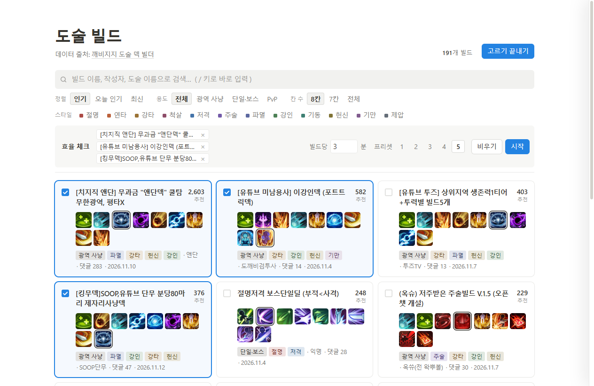

<h1 align="center">도술 빌드 클라이언트</h1>

  도깨비의세계 도술 빌드를 찾아보고, 게임에 바로 장착하고, 사냥 효율을 재서 비교하는 Windows 앱

  
  

  

---

## 할 수 있는 일

| | 기능 | 설명 |
|---|---|---|
| 🔎 | **빌드 찾기** | 깨비지지에 올라온 도술 빌드를 인기·최신순으로 보고, 용도·칸 수·계열로 거릅니다. |
| 🧩 | **도술 포함 검색** | 내가 고른 도술이 모두 들어 있는 빌드만 추려 봅니다. |
| ⚡ | **게임에 적용** | 빌드를 고르고 프리셋 번호를 누르면 도술 장착, 신식 배치, 사용 순서까지 대신 맞춰 줍니다. |
| 📊 | **효율 체크** | 빌드 여러 개를 차례로 장착해 자동사냥으로 돌려 보고, 엽전·처치 수·최소 HP·물약 소모를 비교합니다. |
| 🗂 | **기록** | 잰 결과가 빌드별로 쌓입니다. 기록에서 바로 다시 장착할 수 있습니다. |
| 🔄 | **자동 업데이트** | 새 버전이 나오면 앱 오른쪽 아래에서 물어보고, "예"를 누르면 알아서 받아 설치합니다. |

## 설치

1. **[DosulBuildClient-Setup.exe 내려받기](https://github.com/sk47kt/dosul-build-client-releases/releases/latest/download/DosulBuildClient-Setup.exe)** (약 120MB)
2. 받은 파일을 실행합니다. 설치가 끝나면 앱이 바로 열리고, 바탕화면과 시작 메뉴에 "도술 빌드 클라이언트" 바로가기가 생깁니다.

> **"Windows의 PC 보호" 창이 뜨면** 코드 서명이 없는 프로그램이라 나오는 경고입니다. `추가 정보` → `실행`을 누르면 설치됩니다.

필요한 환경: Windows 10/11 (64bit), 한국어 언어 팩(효율 체크의 숫자 읽기에 사용)

## 게임 쪽 준비

"게임에 적용"과 "효율 체크"를 쓰려면 게임이 아래 상태여야 합니다. 빌드를 찾아보기만 할 때는 게임이 꺼져 있어도 됩니다.

- 게임이 **켜져 있고 창이 최소화되어 있지 않을 것** (다른 창에 가려져 있는 것은 괜찮습니다. 앱이 알아서 앞으로 가져옵니다)
- 해상도는 **16:9** (1280×720, 1600×900, 1920×1080 등). `메뉴 → 설정 → 환경`에서 바꿉니다.
- UI 크기는 작게·보통·크게·아주 크게 어느 것이든 됩니다. 앱이 알아서 알아냅니다.
- 작업이 도는 동안에는 **마우스와 키보드를 건드리지 마세요.** 게임 창이 맨 앞에서 밀려나면 앱이 스스로 멈춥니다.

## 사용법

### 1. 빌드 찾기

- 위쪽 검색창에 빌드 이름이나 작성자를 입력합니다. `/` 키를 누르면 바로 입력할 수 있습니다.
- `정렬`(인기 · 오늘 인기 · 최신), `용도`(광역 사냥 · 단일·보스 · PvP), `칸 수`, `스타일`로 거릅니다.
- **도술 포함**: `+ 도술 고르기`를 눌러 도술을 고르면, 고른 도술이 **모두** 들어 있는 빌드만 남습니다. 이름이나 초성(예: `ㅇㅅㅂㄱ`)으로 찾을 수 있습니다.
- 카드를 누르면 오른쪽에 상세 패널이 열립니다. 사용 순서, 칸 배치, 작성자 설명을 볼 수 있습니다.

### 2. 게임에 적용

1. 빌드 카드를 눌러 상세 패널을 엽니다.
2. 맨 위에서 **덮어쓸 프리셋 번호(1~5)** 를 고릅니다.
3. **게임에 적용**을 누르고 확인합니다.

앱이 하는 일은 이렇습니다.

- 게임이 도술 화면이 아니면 스스로 들어갑니다.
- 고른 프리셋의 도술을 모두 빼고, 빌드의 도술을 하나씩 찾아 넣습니다. 넣을 때마다 맞는 도술인지 확인합니다.
- **신식(궁극기)** 이 의도대로 켜지도록 같은 계열 3개를 아래 줄에 모으고 나머지는 떨어뜨려 놓습니다.
- `도술 설정`의 **사용 순서**를 빌드에 적힌 순서로 맞춥니다.

보통 15~25초가 걸립니다. 갖고 있지 않은 도술이 있으면 그 칸은 건너뛰고 무엇이 빠졌는지 알려 줍니다.

### 3. 효율 체크

같은 자리에서 빌드 여러 개를 차례로 돌려 보고 어느 쪽이 나은지 숫자로 비교합니다.

1. 게임에서 **사냥할 자리에 캐릭터를 세워 둡니다.**
2. 앱 오른쪽 위 **효율 체크**를 누르면 카드에 체크 칸이 생깁니다. 재고 싶은 빌드를 눌러 담습니다.
3. 필터 아래 줄에서 **빌드당 시간(분)** 과 **시험에 쓸 프리셋 번호**를 고르고 **시작**을 누릅니다.

빌드마다 장착 → 자동사냥 켜기 → 절전모드 화면에서 측정 순으로 진행하고, 끝나면 표가 채워집니다.

| 항목 | 뜻 |
|---|---|
| 최소 HP | 재는 동안 HP가 가장 낮았던 순간의 비율 |
| 엽전 · 분당 엽전 | 그동안 번 엽전과 1분당 환산값 |
| 처치 · 분당 처치 | 잡은 몬스터 수와 1분당 환산값 |
| 물약 | 줄어든 물약 개수 (글씨가 작아 못 읽는 경우 "못 읽음"으로 표시) |

- 모두 재고 나면 **분당 엽전이 가장 높았던 빌드를 자동으로 장착**해 두고, 자동사냥은 켠 채로 둡니다.
- 몬스터가 나오는 흐름에 따라 값이 흔들리므로 **빌드당 3분 이상** 재는 것을 권합니다.
- 도중에 죽거나 자동사냥이 오래 멈추면 그 빌드는 일찍 끝내고 사유를 적습니다.

### 4. 기록

- 제목 아래 **기록** 탭에 잰 결과가 빌드별로 모입니다. 평균 분당 엽전이 높은 순으로 정렬됩니다.
- 빌드 줄을 누르면 **도술 목록**, **바로 적용** 버튼, 측정 한 번 한 번의 내역이 펼쳐집니다.
- 기록은 이 PC에만 저장됩니다.

### 5. 업데이트

새 버전이 나오면 앱 오른쪽 아래에 **"새 버전이 있어요. 업데이트할까요?"** 가 뜹니다. `예`를 누르면 바뀐 부분만 받아 설치하고 앱이 다시 열립니다(15초 안팎). `나중에`를 누르면 그대로 계속 쓸 수 있습니다.

## 꼭 알아 두세요

- 이 앱은 **비공식 도구**입니다. 게임 운영사, 깨비지지 어느 쪽과도 관련이 없습니다.
- "게임에 적용"과 "효율 체크"는 **게임 화면을 보고 마우스·키보드 입력을 대신 보냅니다.** 게임 메모리나 프로세스는 건드리지 않지만, 운영정책에 따라 외부 프로그램 사용으로 제재될 수 있습니다. **사용에 따른 책임은 사용하는 분에게 있습니다.**
- 빌드 데이터는 [깨비지지(kkaebigg.com)](https://kkaebigg.com/deck/)의 공개 목록을 가져와 보여 줍니다. 빌드의 저작자는 각 작성자입니다.

## 문제가 생기면

| 증상 | 확인할 것 |
|---|---|
| "게임 창을 찾지 못했어요" | 게임이 켜져 있는지 확인합니다. |
| "16:9 비율 해상도에서만 동작해요" | `설정 → 환경 → 해상도`를 16:9로 바꿉니다. |
| "게임 창이 맨 앞에 있지 않아서 입력을 멈췄어요" | 작업 중에 다른 창을 누른 경우입니다. 다시 시작합니다. |
| 도술이 "미보유(잠김)"로 나옴 | 그 도술을 갖고 있지 않습니다. 다른 빌드를 고르거나 해당 칸을 직접 채웁니다. |
| "절전모드 화면을 열지 못했어요" | 필드 화면에 알림 창이 떠 있지 않은지 확인하고 다시 시도합니다. |
| 숫자가 이상하게 읽힘 | 측정 시간을 늘려 다시 잽니다. 물약 개수는 글씨가 작아 가장 틀리기 쉽습니다. |
